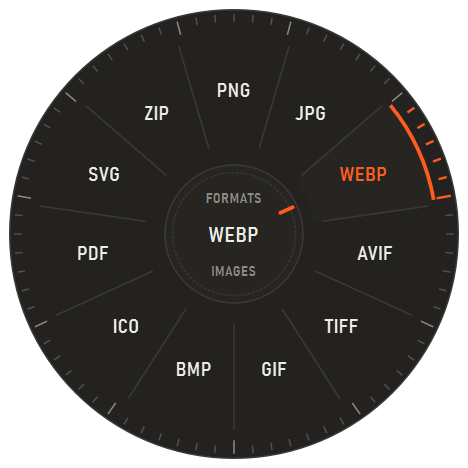
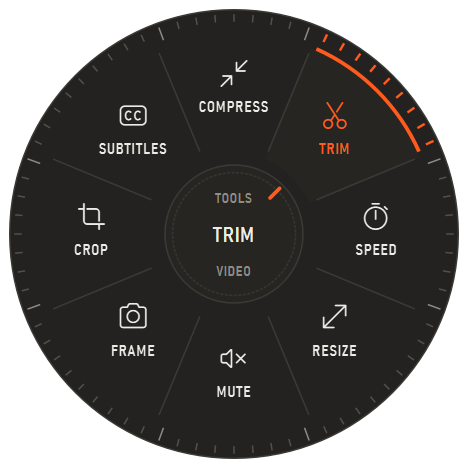
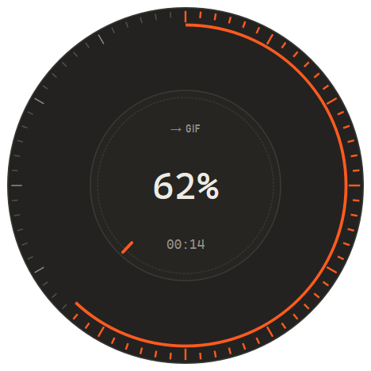
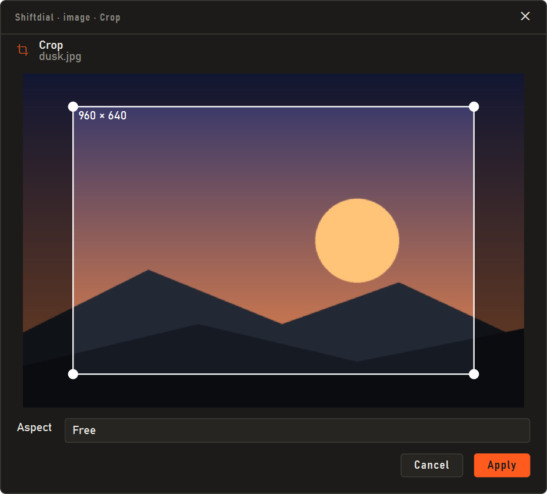

# Shiftdial

Convert files without opening anything. Start dragging files in Explorer, press **Shift**, and a dial
opens under the cursor. Drop on a format. The result lands next to the original.

<p align="center"></p>

Press **Ctrl+Shift** instead and you get tools: trim a video, crop a photo, compress a PDF, extract an
archive. Windows only, everything runs locally, no account, no network.

<p align="center">
  
  
</p>

## Using it

| While dragging from Explorer | |
|---|---|
| Shift (or F8) | formats |
| Ctrl+Shift (or F9) | tools |
| Esc, or drag off the dial | cancel |

After a drop the dial turns into a progress gauge and closes when the job is done; click it to open the
folder. If you close it early, or a job fails or needs an archive password, a small card in the
bottom-right corner takes over.

Tools that need settings open a small window with a preview.

<p align="center"></p>

Outputs never replace anything: `photo.png` becomes `photo (1).png` if the name is taken. A cancelled or
failed job leaves nothing behind.

## What it converts

| From | To |
|---|---|
| Images: PNG, JPG, WEBP, AVIF, HEIC, GIF, TIFF, BMP, ICO, TGA, PSD, QOI, DDS, JPEG 2000, camera RAW | PNG, JPG, WEBP, AVIF, TIFF, GIF, BMP, ICO, PDF, SVG (traced) |
| SVG, EMF, WMF | PDF, PNG, JPG |
| Video: MP4, MOV, MKV, WEBM, AVI, WMV, TS, 3GP, … | MP4, HEVC, AV1, WEBM, MKV, MOV, AVI, GIF, APNG, MP3 |
| Audio: MP3, M4A, WAV, FLAC, OGG, OPUS, WMA, AIFF, APE, … | MP3, M4A, AAC, OPUS, OGG, FLAC, WAV, AIFF, ALAC, WMA |
| Subtitles: SRT, ASS, VTT | each other |
| PDF | PNG/JPG/SVG per page, TXT, CBZ, DOCX\* |
| Word, Excel, PowerPoint and OpenDocument files | PDF and each other\*, CSV/JSON from sheets, PNG per slide |
| TXT, Markdown, HTML | PDF, HTML, Markdown, TXT, DOCX\* |
| EPUB, MOBI, AZW3, FB2, CBZ, XPS | PDF, TXT |
| JSON, YAML, TOML, XML, JSON Lines | each other, CSV, XLSX |
| TTF, OTF, WOFF, WOFF2 | each other |
| GLB, STL, OBJ, PLY, OFF, 3MF | GLB, STL, OBJ, PLY, OFF |
| DXF | PDF, SVG, PNG |
| ZIP, 7Z, RAR, TAR, ISO, CAB | extract (password-protected too), or repack |
| anything, folders included | ZIP, 7Z, TAR.GZ |

\* Uses the Microsoft Office you already have, or LibreOffice.

Tools: resize, compress, crop, rotate, grayscale, watermark and strip EXIF for images; trim, crop,
resize, speed, mute, compress to a target size, grab a frame and pull out subtitles for video; trim,
normalize and mono/stereo for audio; merge, split, rotate, delete pages and compress for PDF.

## Install

Grab `Shiftdial.zip` from [Releases](../../releases), unzip it somewhere permanent and run
`Shiftdial.exe`. Windows SmartScreen will warn because the build isn't signed: *More info → Run anyway*.
Turn on *Start with Windows* from the tray icon.

## Run from source

Needs Windows 10/11 and 64-bit Python 3.12.

```
py -3.12 -m venv .venv
.venv\Scripts\python -m pip install -r requirements.txt
.venv\Scripts\python -m shiftdial.main
```

There's a command line too:

```
.venv\Scripts\python -m shiftdial.cli convert photo.heic --to webp
.venv\Scripts\python -m shiftdial.cli tool clip.mp4 --name video:trim --param start=1 --param end=5
```

Tests: `.venv\Scripts\python -m pytest -q`. Build the exe: `powershell -ExecutionPolicy Bypass -File build.ps1`.

## How it works

A background thread reads the mouse button and the Shift/Ctrl keys every 8 ms. It only reads them, so it
never slows the cursor or swallows a click, and it ignores drags that don't start in Explorer. When Shift
goes down mid-drag, the dial window appears under the cursor and becomes the drop target.

Drops are always accepted as *copy*. Shift on its own means *move* to Explorer, and accepting a move
would make Explorer delete your originals.

Conversions run in a two-job queue: ffmpeg for audio and video, Pillow for images, PyMuPDF for PDFs and
e-books, Windows' own `tar.exe` (or 7-Zip) for archives, and Office through COM for documents. Each
output is written to `name.tmp.ext` and renamed only when it's complete.

Settings live in `%LOCALAPPDATA%\Shiftdial\settings.json`, logs in `%LOCALAPPDATA%\Shiftdial\logs`.

## Licence

MIT for the code in this repository (see [LICENSE](LICENSE)). The release bundles ffmpeg (GPL) and
PyMuPDF (AGPL), whose licences apply to the built app.
